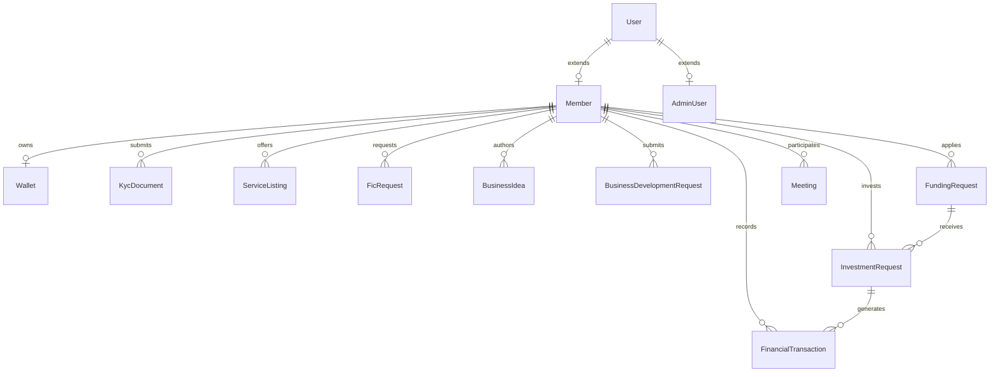
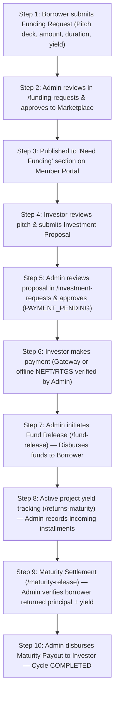
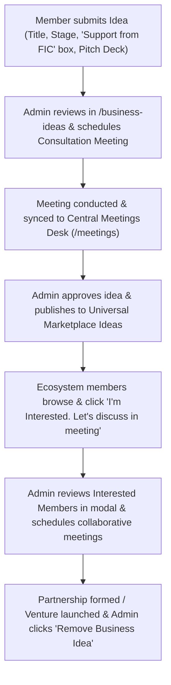
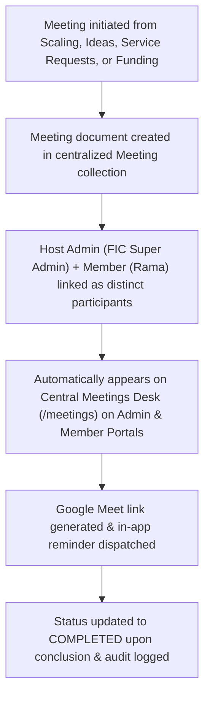

# FIC BUSINESS HUB
## Complete Project Master Architecture Blueprint & Living Baseline

**Document Type:** Consolidated Master Technical Blueprint (BRD + PRD + SRS + Solution Architecture + Data & API Design + Financial Engineering + Security & Governance + Deployment)**Version:** 3.0 (Living Baseline — Fully Aligned with Live Production Codebase)**Status:** Approved Technical Architecture & Active Operational Standard**Prepared for:** FIC Business Hub (Forge India Connect Pvt. Ltd.)**Technology Stack:** MERN (MongoDB Atlas + Express.js + React 19/Vite + Node.js 20+) + 100% TypeScript + Turborepo + pnpm Workspaces + Motion for React + Tailwind CSS**Date:** November 2026

---

# Document Control

| Field | Details |
| :--- | :--- |
| **Project Name** | FIC Business Hub (Forge India Connect Pvt. Ltd.) |
| **Document Version** | 3.0 (Complete Living Production Baseline) |
| **Document Classification** | Enterprise Technical Specification & Production Architecture |
| **Primary Applications** | Member Web Portal (`apps/web`), Admin Operations Portal (`apps/admin`) |
| **Backend API** | Shared Modular Monolith API (`apps/backend`) |
| **Primary Database** | MongoDB Atlas (Mongoose 8 ODM) |
| **Repository Structure** | Turborepo + pnpm monorepo with centralized dynamic RBAC and shared packages |
| **Core Governance Model** | FIC Intermediary Governance (Unmediated direct company-to-company bypass strictly prohibited) |

---

## Document Evolution & Key Architectural Milestones

### v1.0 &rarr; Initial Monorepo Foundation & Governance Concept
- Initial establishment of Turborepo monorepo with member portal, admin stub, and shared Express backend.
- Conceptualization of the FIC Intermediary Model to protect against directory bypass.

### v2.0 &rarr; Intermediary Governance Enforcement & Student/Mentor Ecosystem
1. **Permanent Retirement of Unmediated Partnerships**: Standalone direct member-to-member partnership connections were permanently removed to prevent off-platform commercial bypass. All B2B trade, supplier discovery, subcontractor sourcing, and OEM tie-ups were routed through the **Universal Services Marketplace**, **Enterprise Scaling Desk**, and **Facilitated Meetings Desk**. Legacy `/partnerships` route permanently redirects to `/my-requests`.
2. **Two Distinct Advisory Desks**:
   - **Business Ideas & Incubation Desk (`/business-ideas`)**: Focused on **Stage 0 &rarr; 1** pre-launch concept validation, bilateral NDA protection, automated 3-metric feasibility scoring (Market Viability, Technical Feasibility, Commercial Scalability), and mentor review notes.
   - **Business Development & Enterprise Scaling (`/business-development` / `/scaling`)**: Focused on **Stage 1 &rarr; 10** operational turnaround for existing enterprises, factory floor lean optimization, cloud ERP modernization, distributor channel expansion, and phased diagnostic roadmaps.
3. **Dedicated Student & Mentor Ecosystem**: Full specialized portals for:
   - **Student Talent & Skill Development (`/skill-development`)**: Masterclass discovery filtered by domain and language (Tamil, English, etc.), and 1-on-1 consultation booking.
   - **Mentor Workspace (`/my-services`, `/my-requests`)**: Streamlined masterclass video upload form (Topic Domain, Language, Video File Upload, Duration, Curriculum), teaching services catalog, and consultation management (`Accept`, `Reject`, `Reschedule`, `Complete & Log Audit`).
4. **Motion for React Design System**: Migration to official `motion/react` v12+, standardized motion tokens, and layout-level zero-opacity protection to guarantee 100% viewport visibility on route navigation.
5. **Warm Ivory & Soft Sand Luxury Theme**: Sophisticated multi-color Warm Ivory (`#FAF7F2`) surface with deep Earth Brown text (`#51463F`, `#453A33`) exceeding WCAG AAA contrast (> 7.5:1 ratio).

### v3.0 &rarr; Complete Living Production Architecture (November 2026 Baseline)
1. **Centralized Customer Meetings Desk (`/meetings`)**:
   - Aggregates all meetings scheduled across ANY module (Business Ideas, Scaling Advisory, Stage 1 & Stage 2 Service Requests, Funding/Investment, and Custom Consultations) into a single centralized operational desk.
   - Complete synchronization across Member Website (`/meetings`) and Admin Portal (`/meetings`).
   - Clean, dual-participant display breakdown: shows requesting Member (e.g., *Rama*) and Host Admin (e.g., *FIC Super Administrator*) rather than confusing duplicate names.
   - Full meeting lifecycle tracking: `SCHEDULED`, `COMPLETED`, `CANCELLED`, `RESCHEDULED` with verified virtual video session links (Google Meet), duration, notes, and automated invite dispatch logs.
2. **Business Ideas Collaboration & Universal Marketplace Integration**:
   - Member submits Business Idea with target market, idea stage, "What support do you need from FIC?" with dedicated custom description box, and pitch deck/supporting documents.
   - Admin reviews idea in Admin Portal (`/business-ideas`) and arranges an advisory consultation meeting with the submitter.
   - Upon meeting completion & validation, Admin approves idea and publishes it to the **Universal Marketplace under Business Idea Requests**.
   - Other verified ecosystem members can browse published ideas and submit collaboration interest: *"I'm interested. Let's discuss more about this business idea in meeting."*
   - Admin reviews interested members directly inside the Business Idea Detail Modal and schedules/reschedules meetings with them.
   - Obsolete shortlisted/selection buttons permanently removed.
   - Added **"Remove Business Idea"** action for Admin to conclude ideas once objectives are achieved or no longer active.
3. **Enterprise Scaling Request In-App Document Preview**:
   - Integrated `AuthenticatedDocumentPreview` modal component for instant in-app viewing of supporting PDFs and images without opening raw JSON unauthorized error pages.
   - Provides secure tokenized document streaming, MIME type detection, SHA-256 checksum verification, and download capabilities.
4. **Member Financial Overview in Admin Members Directory**:
   - In Admin Portal &rarr; Members Directory &rarr; Member Profile Modal, added two dedicated financial overview tabs:
     1. **Funding & Loans Tab**: Active funding applications, required capital, approved funding amounts, outstanding balances, loan repayment statuses, and repayment schedules.
     2. **Investments & Yields Tab**: Committed investment amounts, funded project allocations, expected return yields, payout frequencies, next due dates, and repayment history.
5. **Complete Funding & Investment Lifecycle Management**:
   - Eliminated the combined tabbed funding desk in the Admin Portal.
   - Created **Five Completely Separate Standalone Admin Sidebar Modules**:
     1. **Funding Requests** (`/funding-requests`): Review, document inspection, request changes, approve for marketplace listing, or reject with formal feedback.
     2. **Investment Requests** (`/investment-requests`): Investor proposal review, ticket size validation, approval triggering payment pending obligation, or rejection.
     3. **Fund Release** (`/fund-release`): Verification of investor payments (gateway or offline bank transfer), escrow allocation, disbursement to borrower, and formal disbursement receipts.
     4. **Returns & Maturity** (`/returns-maturity`): Active funded project tracking, scheduled return monitoring, recording incoming borrower return installments, and installment ledgers.
     5. **Maturity Release** (`/maturity-release`): Principal + return reconciliation, incoming borrower final maturity verification, investor payout release, and formal settlement receipts.
   - **Executive Dashboard 11 Financial Lifecycle KPIs**: Real-time MongoDB-aggregated metrics displaying deal count, aggregate INR values, color-coded indicators, and click-through navigation with preset filters.
   - **End-to-End 10-Step Financial Workflow**: Fully implemented with double-entry `FinancialTransactionModel` and digital wallet integration.

---

# 1. Executive Summary

FIC Business Hub is an enterprise-grade, intermediary-governed business, professional, and opportunity ecosystem developed for **Forge India Connect Pvt. Ltd.**. It unites MSMEs, manufacturers, entrepreneurs, startup innovators, investors, service providers, mentors, and students across India into a single trusted, verified platform.

Unlike open directories, lead brokers, or unmoderated social platforms, **FIC Business Hub operates under strict intermediary governance**:
- **Identity Privacy Shield**: Provider identities and direct contact numbers are never published on open public feeds.
- **Vetted Introductions**: Inquiries, vendor matching, supplier discovery, and investor introductions are reviewed, verified, and coordinated directly by FIC Officers.
- **Zero Bypass Vulnerability**: Standalone unmoderated partnerships have been eliminated. All commercial opportunities flow through structured, moderated channels.

### Monorepo Architecture Overview
The platform is organized as a high-performance monorepo powered by **Turborepo** and **pnpm workspaces**:

```text
FIC-BusinessHub/
├── apps/
│   ├── web/                         # Website 1: Member Web Portal & Marketing Site (Port 5173)
│   ├── admin/                       # Website 2: FIC Admin & Operations Portal (Port 5174)
│   └── backend/                     # Shared Modular Monolith REST API (Port 5000)
├── packages/
│   ├── shared-types/                # Shared TypeScript models, enums & interfaces
│   ├── validators/                  # Shared Zod runtime validation schemas
│   ├── ui/                          # Shared UI component library & brand assets
│   ├── api-client/                  # Unified Axios/Fetch API client
│   ├── auth/                        # Shared authentication helpers & RBAC policies
│   ├── typescript-config/           # Centralized tsconfig presets
│   ├── eslint-config/               # Centralized ESLint rules
│   └── tailwind-config/             # Shared Tailwind CSS design tokens
├── infrastructure/                  # Docker, AWS S3, and production deployment scripts
└── docs/                            # Master Project Blueprint & Architecture Specifications
```

---

# 2. Business Requirements Document (BRD)

## 2.1 Business Vision & Mission
- **Vision**: Bring every eligible enterprise, professional, innovator, and student into one trusted ecosystem and empower them to discover, offer, and execute business opportunities through FIC intermediary governance.
- **Positioning Statement**: *"One Platform. Unlimited Opportunity Ecosystem."*

## 2.2 Core Business Objectives
1. Build a multi-sector membership ecosystem for verified individuals and organizations aged 18 and above.
2. Enable members to publish verified service capabilities and submit business requirements.
3. Make approved services discoverable across all 10 business sectors via a Universal Services Marketplace.
4. Enforce FIC-mediated business introductions and eliminate direct, unmoderated commercial bypass.
5. Provide a dedicated **Business Ideas & Incubation Desk** for Stage 0 &rarr; 1 pre-launch concepts.
6. Provide an **Enterprise Scaling Desk** for Stage 1 &rarr; 10 operational turnaround and factory modernization.
7. Enable an **End-to-End Funding & Investment Lifecycle** with double-entry escrow tracking and repayment schedules.
8. Deliver an integrated **Student & Mentor Ecosystem** for video masterclasses and 1-on-1 consultations.
9. Maintain a **Centralized Customer Meetings Desk** for complete visibility of all scheduled sessions across the ecosystem.
10. Deliver dynamic, role-tailored member dashboards dynamically configured from a single source of truth (`dashboardConfig.ts`).

## 2.3 Ten Core Industry Sectors
The ecosystem classifies all participants, service listings, business ideas, and scaling requests into 10 core business sectors:
1. **Business & Entrepreneurship**: Business Owners, Startup Founders, Franchise Operators, Early Innovators.
2. **Manufacturing & Industrial**: Factory Owners, Textile & Garments, Heavy Machinery, OEM Subcontractors.
3. **Information Technology & Services**: Software Developers, Cloud Architects, Cybersecurity, AI/ML Engineers.
4. **Healthcare & Life Sciences**: Doctors, Clinic Administrators, Diagnostic Centers, Ayurvedic Practitioners.
5. **Retail & E-Commerce**: Wholesalers, Retailers, Regional Distributors, Direct-to-Consumer Brands.
6. **Education & EdTech**: Students, Faculty Mentors, Corporate Trainers, Academic Institutions.
7. **Financial & Legal Services**: Chartered Accountants, Legal Advisors, Tax Consultants, Compliance Experts.
8. **Real Estate & Construction**: Builders, Civil Contractors, Architects, Commercial Facility Managers.
9. **Creative, Media & Lifestyle**: Designers, Content Creators, Branding Specialists, Media Production.
10. **Renewable Energy & Environment**: Solar Installers, Waste Management, EV Infrastructure, Green Tech.

## 2.4 Membership & Financial Model
- **First-Year Introductory Membership**: ₹99 (one-time onboarding fee).
- **Subsequent Annual Renewal**: ₹5,999 per year.
- **Fair Pricing Standard**: Uniform pricing across all sectors; no deceptive countdown timers or false crossed-out pricing.
- **Payment Gateway Integration**: Razorpay payment order creation and webhook-verified transaction signing.
- **Wallet & Ledger System**: Every member receives a digital wallet tracking active balance, locked escrow balance, and transaction history.
- **Referral Rewards**: Multi-tier referral bonus system crediting commissions directly to member wallets upon referred member activation.

---

# 3. Product Requirements Document (PRD)

## 3.1 Web Applications Architecture

### Website 1: FIC Business Hub Member Portal (`apps/web`)
- **Port**: 5173 (Development) / Production Custom Domain.
- **Layout Architecture**:
  1. `PublicLayout`: High-conversion landing page, about, membership details, contact, privacy policy, and terms. Includes full public header and comprehensive marketing footer.
  2. `AuthLayout`: Minimalist, distraction-free layout for get started, registration, login, and KYC submission tracking.
  3. `MemberLayout`: Secure authenticated member workspace featuring top navigation header, role-based action cards, notification bell, user profile drawer, and compact member footer (strictly excludes marketing footer).

### Website 2: FIC Admin & Operations Portal (`apps/admin`)
- **Port**: 5174 (Development) / Production Admin Domain.
- **Layout Architecture**:
  - `AdminLayout`: High-contrast luxury theme with fixed/collapsible sidebar, universal header with Royal Midnight gradient, notification system, admin profile settings modal, and fast-action search.

---

## 3.2 Member Portal Modules & User Journeys

### 1. Dynamic Member Dashboard (`/dashboard`)
Configured dynamically via `apps/web/src/services/dashboardConfig.ts`:
- **Identity Banner**: Displays member name, category, subcategory, verified KYC badge, and digital wallet balance.
- **Dynamic KPI Stat Cards**: 4 responsive metrics tailored to the member's sector (e.g., *Registered Students*, *My Teaching Services*, *Client Inquiries*, *Active Deal Rooms*).
- **Opportunity Actions Grid**: 7-8 high-impact action shortcuts explicitly marked *"Moderated by FIC Intermediary Governance"*.
- **Specialized Track Spotlight**: Domain-specific accelerator showcase (e.g., *Student Talent Accelerator*, *Deal Room Showcase*).

### 2. Universal Services Marketplace (`/marketplace`)
- Discover approved capabilities across all 10 sectors.
- **Field-Level Identity Shield**: Hides personal names, phone numbers, email addresses, and company names.
- Public display includes: Service Title, Category/Subcategory, Deliverables List, Industry Badges, FIC Verification Stamp, Response Timeframe, and *"Request Service through FIC"* CTA.
- Tabbed browsing: All Services, Filter by Sector, Subcategory selector, and **Business Idea Requests** tab.

### 3. Business Ideas & Innovation Hub (`/business-ideas`)
- Early-stage concept validation (**Stage 0 &rarr; 1**).
- **Submission Form**:
  - Idea Title & Concept Description.
  - Target Market & Geography.
  - Development Stage (*Just an Idea / On Paper*, *Prototype / MVP*, *Early Traction*, *Growth*).
  - **Support Requirements**: Multi-select options plus dedicated custom description box: *"What support do you need from FIC?"*.
  - Supporting Documents: Pitch deck, executive summary, product diagram.
- **Feasibility Scoring Engine**: Automated 3-metric score (*Market Viability*, *Technical Feasibility*, *Commercial Scalability*).
- **Collaboration Lifecycle**:
  - Submitter meets with FIC advisor.
  - Admin validates and publishes idea to Universal Marketplace.
  - Interested members click *"I'm interested. Let's discuss more about this business idea in meeting."*
  - Admin conducts meetings with interested parties directly from the idea detail modal.
  - Admin concludes and archives completed ideas via *"Remove Business Idea"*.

### 4. Enterprise Scaling & Advisory Hub (`/business-development` / `/scaling`)
- Operational turnaround for existing operational enterprises (**Stage 1 &rarr; 10**).
- **Submission Form**: Enterprise Name, Sector, Operational Stage, Core Business Challenges, Required Support Areas, and Supporting Documents.
- **In-App Document Preview**: Integrated preview modal for inspecting uploaded balance sheets, certificates, and pitch decks without unauthorized token errors.
- **Advisory Consultation**: Scheduled consultation meeting displayed directly in the scaling card and synchronized with the central Meetings Desk.
- **Diagnostic Roadmaps**: Phased transformation roadmaps formulated by FIC Sector Directors.

### 5. Complete Funding & Investment Hub (`/investment`)
- Institutional deal room connecting capital seekers with accredited investors.
- **Need Funding Listings**: Detailed parameters including Required Capital, Min/Max Ticket Size, Duration, Expected Return Rate (%), Return Payout Frequency (Monthly, Quarterly, Annual, At Maturity), Purpose of Funds, and Pitch Deck.
- **Investor Proposal Modal**: Investors select a funded project, specify proposed investment amount, expected yield share, and investment thesis.
- **Investor Payment Flow**: Once approved by Admin, investors complete payment obligations via Razorpay or offline transfer.
- **Yield & Return Timetable**: Investors track ongoing return installments and scheduled maturity dates.

### 6. Centralized Customer Meetings Desk (`/meetings`)
- Universal operational desk for all consultations across the platform.
- Displays upcoming sessions, meeting title, agenda, scheduled date/time, duration, host admin, and direct *"Join Online Meeting"* CTA.
- Full status filtering: `All Meetings`, `Scheduled`, `Completed`, `Cancelled`.

### 7. My Services & My Requests Desks
- **My Services (`/my-services`)**: Manage published service listings, submit new offerings, and view moderation status. Mentors upload masterclass videos here.
- **My Requests (`/my-requests`)**: Track incoming and outgoing inquiries, service requests, and mentor consultations with interactive actions (`Accept`, `Reject`, `Reschedule`, `Complete`).

### 8. Student & Mentor Skill Development Hub (`/skill-development`)
- Filter masterclasses by topic (Java, Python, Web Dev, Marketing, etc.) and language (Tamil, English, Hindi, Kannada, Telugu).
- Direct booking of 1-on-1 consultations with faculty mentors.

---

## 3.3 Admin Portal Modules & Executive Workspaces

The Admin Portal (`apps/admin`) provides five primary operational functional blocks:

### 1. Core Overview & Live Ledger
- **Dashboard (`/`)**: Live operational KPIs, Financial Revenue Snapshot, Quick Action Toolbar, System Diagnostics, and Real-Time Administrative Audit Stream.
- **11 Lifecycle KPIs**: Dedicated Funding & Investment lifecycle metric grid backed by MongoDB records.

### 2. Members & Compliance Desk
- **Members Directory (`/members`)**: Full member registry with filters, active privilege toggles, and Member Profile Modal containing:
  - Registration Profile
  - Marketplace Services
  - Digital Wallet Ledger
  - Bank Details
  - **Funding & Loans Tab**
  - **Investments & Yields Tab**
- **KYC Verification (`/kyc`)**: Compliance desk for reviewing Aadhaar, PAN, GSTIN, and business proofs with `Approve`, `Reject`, or `Request Clarification` actions.

### 3. Ecosystem Marketplace & Innovation Desks
- **Categories & Config (`/categories`)**: Dynamic sector and subcategory manager.
- **Service Moderation (`/services`)**: Listing moderation desk to enforce privacy compliance before public marketplace publishing.
- **Business Idea Requests (`/business-ideas`)**: Review submitted ideas, arrange consultation meetings, approve to marketplace, manage interested member collaboration responses, schedule meetings, and remove concluded ideas.
- **Scaling Requests (`/scaling`)**: Review enterprise scaling applications, inspect documents via `AuthenticatedDocumentPreview`, and schedule consultation meetings.

### 4. Dedicated Commercials & Capital Desk (5 Independent Modules)
1. **Funding Requests (`/funding-requests`)**: Dedicated module for borrower funding proposals. Features include in-app document preview, change requests with dynamic document requirements, approval with verified amount validation, and formal rejection.
2. **Investment Requests (`/investment-requests`)**: Dedicated module for investor proposals. Features include ticket validation, approval triggering `PAYMENT_PENDING`, change requests, and rejection.
3. **Fund Release (`/fund-release`)**: Dedicated module for capital disbursement. Features include investor payment verification (offline/gateway), escrow reconciliation, disbursement to borrower, and disbursement receipts.
4. **Returns & Maturity (`/returns-maturity`)**: Dedicated module for active funded projects. Features include tracking scheduled returns, recording incoming borrower return installments into sub-document `repayments` array, and ledger updates.
5. **Maturity Release (`/maturity-release`)**: Dedicated module for final investment settlement. Features include principal + yield reconciliation, confirming borrower escrow settlement, disbursing maturity payout to investors, and formal settlement certificates.
- **Payments & Fees (`/payments`)**: Platform revenue ledger and formal receipt generator.
- **Referral Bonus (`/referrals`)**: Track affiliate referrals and bonus disbursements.

### 5. Operations, Governance & Support
- **Meetings & Calls (`/meetings`)**: Centralized meeting management desk showing all scheduled meetings across every module with dual-participant breakdown (Member + Admin) and status management.
- **Service Requests (`/requests`)**: Two-stage service intermediary facilitation desk.
- **Support Helpdesk (`/support`)**: Member support ticket queue.
- **Staff Management (`/staff`)**: Role-based access control for Super Admins, Admins, and Verification Staff.
- **Audit Logs (`/audit-logs`)**: Immutable chronological log of all administrative actions.

---

# 4. Solution Architecture & Technical Design

## 4.1 Monorepo Workspace Structure

```text
packages/
├── shared-types/
│   └── src/
│       ├── user.ts                  # User, Member & AdminUser interfaces
│       ├── category.ts              # Category & Subcategory interfaces
│       ├── kyc.ts                   # KycDocument & status types
│       ├── service.ts               # ServiceListing & FicRequest types
│       ├── ideas.ts                 # BusinessIdea & IdeaInterest types
│       ├── scaling.ts               # BusinessDevelopmentRequest types
│       ├── funding.ts               # FundingRequest & InvestmentRequest types
│       ├── meetings.ts              # Meeting interface & status types
│       ├── financial.ts             # FinancialTransaction & Wallet types
│       └── audit.ts                 # AuditLog interface
├── validators/
│   └── src/                         # Zod schemas for runtime API payload validation
├── ui/
│   └── src/components/              # Shared buttons, cards, badges, inputs & modals
├── api-client/
│   └── src/                         # Base Axios client with automatic token injection
└── auth/
    └── src/                         # JWT decode, token storage & RBAC role checkers
```

---

# 5. Data Architecture & MongoDB Models

## 5.1 Core Entity Relationship Overview



## 5.2 Key Mongoose Schema Definitions

### 1. InvestmentRequestModel (`apps/backend/src/modules/investment/investment.model.ts`)
Includes structured sub-document `repayments` array for active return tracking:
```typescript
const RepaymentInstallmentSchema = new Schema({
  installmentNumber: { type: Number, required: true },
  dueDate: { type: Date, required: true },
  amountDue: { type: Number, required: true },
  amountPaid: { type: Number, default: 0 },
  paidAt: { type: Date },
  paymentReference: { type: String },
  status: { type: String, enum: ['PENDING', 'DUE', 'PAID', 'OVERDUE'], default: 'PENDING' },
  verifiedBy: { type: Schema.Types.ObjectId, ref: 'AdminUser' },
  verifiedAt: { type: Date },
  notes: { type: String }
});

const InvestmentRequestSchema = new Schema({
  fundingRequestId: { type: Schema.Types.ObjectId, ref: 'FundingRequest', required: true },
  investorId: { type: Schema.Types.ObjectId, ref: 'User', required: true },
  proposedAmount: { type: Number, required: true },
  approvedAmount: { type: Number },
  proposedSharePercent: { type: Number },
  status: {
    type: String,
    enum: [
      'SUBMITTED', 'UNDER_REVIEW', 'CHANGES_REQUESTED', 'APPROVED',
      'PAYMENT_PENDING', 'PAID', 'ACTIVE', 'REPAID', 'REJECTED'
    ],
    default: 'SUBMITTED'
  },
  paymentStatus: {
    type: String,
    enum: ['PENDING', 'PAID', 'FAILED', 'REFUNDED'],
    default: 'PENDING'
  },
  paymentReference: { type: String },
  paidAt: { type: Date },
  disbursedAt: { type: Date },
  disbursementReference: { type: String },
  repayments: [RepaymentInstallmentSchema],
  maturityDate: { type: Date },
  totalReturnsPaid: { type: Number, default: 0 },
  maturitySettlementStatus: {
    type: String,
    enum: ['PENDING', 'AWAITING_BORROWER_REPAYMENT', 'READY_FOR_PAYOUT', 'COMPLETED'],
    default: 'PENDING'
  },
  maturityPayoutReference: { type: String },
  maturityPayoutAt: { type: Date }
}, { timestamps: true });
```

### 2. BusinessIdeaModel (`apps/backend/src/modules/business-ideas/business-ideas.model.ts`)
```typescript
const IdeaInterestSchema = new Schema({
  memberId: { type: Schema.Types.ObjectId, ref: 'User', required: true },
  message: { type: String, required: true },
  submittedAt: { type: Date, default: Date.now },
  meetingScheduled: { type: Boolean, default: false },
  meetingDate: { type: Date },
  meetingLink: { type: String }
});

const BusinessIdeaSchema = new Schema({
  authorId: { type: Schema.Types.ObjectId, ref: 'User', required: true },
  title: { type: String, required: true },
  description: { type: String, required: true },
  targetMarket: { type: String, required: true },
  targetLocation: { type: String },
  stage: { type: String, enum: ['IDEA', 'PROTOTYPE', 'EARLY_TRACTION', 'GROWTH'], required: true },
  supportRequirements: [{ type: String }],
  customSupportNotes: { type: String },
  documents: [{
    documentId: { type: String },
    name: { type: String },
    fileUrl: { type: String },
    fileType: { type: String },
    uploadedAt: { type: Date, default: Date.now }
  }],
  feasibilityScore: {
    marketViability: { type: Number, default: 85 },
    technicalFeasibility: { type: Number, default: 80 },
    commercialScalability: { type: Number, default: 90 },
    overallScore: { type: Number, default: 85 }
  },
  status: {
    type: String,
    enum: ['SUBMITTED', 'UNDER_REVIEW', 'MEETING_SCHEDULED', 'APPROVED_MARKETPLACE', 'REJECTED', 'COMPLETED_REMOVED'],
    default: 'SUBMITTED'
  },
  meetingDetails: {
    date: { type: Date },
    time: { type: String },
    link: { type: String },
    status: { type: String, enum: ['PENDING', 'SCHEDULED', 'COMPLETED'] }
  },
  interestedMembers: [IdeaInterestSchema],
  isMarketplaceLive: { type: Boolean, default: false },
  adminNotes: { type: String }
}, { timestamps: true });
```

### 3. MeetingModel (`apps/backend/src/modules/admin/models/Meeting.ts`)
```typescript
const MeetingSchema = new Schema({
  title: { type: String, required: true },
  description: { type: String },
  moduleSource: {
    type: String,
    enum: ['SCALING', 'BUSINESS_IDEA', 'SERVICE_REQUEST', 'FUNDING', 'CUSTOM', 'MENTORING'],
    required: true
  },
  referenceId: { type: Schema.Types.ObjectId },
  hostAdminId: { type: Schema.Types.ObjectId, ref: 'AdminUser' },
  hostAdminName: { type: String, default: 'FIC Super Administrator' },
  participants: [{
    userId: { type: Schema.Types.ObjectId, ref: 'User' },
    name: { type: String, required: true },
    email: { type: String, required: true },
    role: { type: String, enum: ['MEMBER', 'ADMIN', 'INTERESTED_COLLABORATOR', 'MENTOR', 'STUDENT'] }
  }],
  scheduledDate: { type: Date, required: true },
  scheduledTime: { type: String, required: true },
  durationMinutes: { type: Number, default: 45 },
  meetingUrl: { type: String, required: true },
  status: {
    type: String,
    enum: ['SCHEDULED', 'COMPLETED', 'RESCHEDULED', 'CANCELLED'],
    default: 'SCHEDULED'
  },
  invitesDispatched: { type: Boolean, default: true },
  meetingNotes: { type: String }
}, { timestamps: true });
```

### 4. FinancialTransactionModel (`apps/backend/src/modules/payments/financial-transaction.model.ts`)
```typescript
const FinancialTransactionSchema = new Schema({
  transactionId: { type: String, unique: true, required: true },
  userId: { type: Schema.Types.ObjectId, ref: 'User', required: true },
  type: {
    type: String,
    enum: [
      'MEMBERSHIP_FEE', 'SERVICE_PAYMENT', 'INVESTMENT_PAYMENT',
      'FUND_RELEASE', 'RETURN_PAYMENT', 'MATURITY_PAYOUT',
      'WALLET_TOPUP', 'REFERRAL_PAYOUT'
    ],
    required: true
  },
  amount: { type: Number, required: true },
  currency: { type: String, default: 'INR' },
  direction: { type: String, enum: ['CREDIT', 'DEBIT'], required: true },
  status: {
    type: String,
    enum: ['INITIATED', 'PENDING', 'COMPLETED', 'FAILED', 'REFUNDED'],
    default: 'INITIATED'
  },
  paymentGateway: { type: String, enum: ['RAZORPAY', 'BANK_TRANSFER', 'WALLET', 'ESCROW'], default: 'RAZORPAY' },
  gatewayPaymentId: { type: String },
  gatewayOrderId: { type: String },
  bankReference: { type: String },
  metadata: { type: Schema.Types.Mixed },
  auditVerifiedBy: { type: Schema.Types.ObjectId, ref: 'AdminUser' },
  auditVerifiedAt: { type: Date }
}, { timestamps: true });
```

---

# 6. Complete REST API Specification

## 6.1 Member APIs (`/api/v1`)

| Method | Endpoint | Description | Auth Required |
| :--- | :--- | :--- | :--- |
| `POST` | `/auth/register` | Initiates member registration with category selection | No |
| `POST` | `/auth/login` | Member authentication returning JWT & profile | No |
| `GET` | `/auth/me` | Returns authenticated member profile & KYC status | Yes (Member) |
| `GET` | `/dashboard` | Returns dynamic dashboard metrics tailored to sector | Yes (Member) |
| `GET` | `/marketplace` | Returns active services with identity shield | Yes (Member) |
| `POST` | `/services` | Submits new service listing for FIC moderation | Yes (Member) |
| `GET` | `/services/my-services` | Returns member's authored service listings | Yes (Member) |
| `POST` | `/services/:id/request` | Submits service request through FIC intermediary | Yes (Member) |
| `GET` | `/business-ideas` | Returns authored ideas & marketplace approved ideas | Yes (Member) |
| `POST` | `/business-ideas` | Submits new business idea with support requirements | Yes (Member) |
| `POST` | `/business-ideas/:id/interest` | Expresses collaboration interest for published idea | Yes (Member) |
| `POST` | `/scaling` | Submits operational scaling advisory request | Yes (Member) |
| `GET` | `/scaling/my-requests` | Returns member's scaling advisory submissions | Yes (Member) |
| `GET` | `/investment/need-funding` | Returns approved funding proposals on marketplace | Yes (Member) |
| `POST` | `/investment/proposals` | Submits investor ticket proposal for target project | Yes (Member) |
| `GET` | `/meetings/my-meetings` | Returns all scheduled sessions for the member | Yes (Member) |
| `GET` | `/documents/:id/view` | Streams secure authenticated document content | Yes (Member/Admin) |
| `GET` | `/documents/:id/download` | Secure document download with filename headers | Yes (Member/Admin) |

## 6.2 Admin Portal APIs (`/api/admin`)

| Method | Endpoint | Description | Auth Required |
| :--- | :--- | :--- | :--- |
| `GET` | `/dashboard/stats` | Returns operational KPIs & recent audit logs | Yes (Admin) |
| `GET` | `/dashboard/financial-stats` | Returns monthly revenue breakdown | Yes (Admin) |
| `GET` | `/members` | Returns all members with filters & KYC status | Yes (Admin) |
| `GET` | `/members/:id` | Returns detailed member profile & financial overview | Yes (Admin) |
| `GET` | `/members/:id/financials` | Returns member funding loans & investment yields | Yes (Admin) |
| `PUT` | `/kyc/:id/review` | Approves, rejects, or requests KYC clarification | Yes (Admin) |
| `GET` | `/services` | Moderation queue for marketplace services | Yes (Admin) |
| `PUT` | `/services/:id/moderate` | Approves or rejects service listing | Yes (Admin) |
| `GET` | `/business-ideas` | Returns all submitted business ideas | Yes (Admin) |
| `POST` | `/business-ideas/:id/arrange-meeting` | Schedules advisory meeting with idea submitter | Yes (Admin) |
| `PUT` | `/business-ideas/:id/approve` | Publishes idea to Universal Marketplace | Yes (Admin) |
| `DELETE` | `/business-ideas/:id` | Concludes & removes completed business idea | Yes (Admin) |
| `GET` | `/scaling` | Returns all scaling advisory applications | Yes (Admin) |
| `POST` | `/scaling/:id/schedule-meeting` | Schedules diagnostic consultation meeting | Yes (Admin) |
| `GET` | `/meetings` | Centralized meeting desk with status filters | Yes (Admin) |
| `POST` | `/meetings` | Schedules new consultation session | Yes (Admin) |
| `PUT` | `/meetings/:id` | Updates status (COMPLETED / CANCELLED / RESCHEDULED) | Yes (Admin) |
| `GET` | `/funding/requests` | Returns all funding requests with filters | Yes (Admin) |
| `PUT` | `/funding/requests/:id/review` | Marks funding request under review | Yes (Admin) |
| `PUT` | `/funding/requests/:id/approve` | Approves funding request for marketplace listing | Yes (Admin) |
| `PUT` | `/funding/requests/:id/reject` | Rejects funding request with formal notes | Yes (Admin) |
| `GET` | `/funding/investment-requests` | Returns investor proposals with ticket filters | Yes (Admin) |
| `PUT` | `/funding/investment-requests/:id/approve` | Approves proposal, triggers PAYMENT_PENDING | Yes (Admin) |
| `GET` | `/funding/fund-releases` | Returns projects ready for escrow fund release | Yes (Admin) |
| `POST` | `/funding/fund-releases/:id/verify-payment` | Verifies offline investor payment, updates ledger | Yes (Admin) |
| `POST` | `/funding/fund-releases/:id/release` | Disburses approved funds from escrow to borrower | Yes (Admin) |
| `GET` | `/funding/returns-maturity` | Returns active funded projects & yield schedules | Yes (Admin) |
| `POST` | `/funding/returns-maturity/:id/record-repayment` | Records incoming borrower return installment | Yes (Admin) |
| `GET` | `/funding/maturity-releases` | Returns matured deals ready for final settlement | Yes (Admin) |
| `POST` | `/funding/maturity-releases/:id/verify-incoming` | Confirms receipt of borrower's maturity payment | Yes (Admin) |
| `POST` | `/funding/maturity-releases/:id/release` | Disburses maturity payout back to investor | Yes (Admin) |
| `GET` | `/funding/lifecycle-kpis` | Computes the 11 MongoDB-aggregated lifecycle KPIs | Yes (Admin) |

---

# 7. End-to-End Key Business Workflows

## 7.1 Complete Funding & Investment Lifecycle (10 Steps)



## 7.2 Business Idea Incubation & Collaboration Lifecycle



## 7.3 Centralized Meetings Management Workflow



---

# 8. Executive Dashboard — 11 Lifecycle Financial KPIs

Computed live via `GET /api/admin/funding/lifecycle-kpis` across `FundingRequestModel` and `InvestmentRequestModel`:

| KPI Name | Query Logic | Target Page Navigation | Preset Filter |
| :--- | :--- | :--- | :--- |
| **1. Total Funding Requested** | Sum of `requiredAmount` for all `FundingRequest` records | `/funding-requests` | `status=ALL` |
| **2. Total Funding Approved** | Sum of `approvedAmount` where `status = 'APPROVED'` | `/funding-requests` | `status=APPROVED` |
| **3. Total Investment Proposals** | Sum of `proposedAmount` for all `InvestmentRequest` records | `/investment-requests` | `status=ALL` |
| **4. Total Investment Approved** | Sum of `approvedAmount` where `status IN ('APPROVED', 'PAYMENT_PENDING', 'PAID', 'ACTIVE')` | `/investment-requests` | `status=APPROVED` |
| **5. Verified Investor Payments** | Sum of payments where `paymentStatus = 'PAID'` | `/fund-release` | `status=ALL` |
| **6. Total Funds Released** | Sum of disbursed amounts where `status = 'ACTIVE'` and `disbursedAt != null` | `/fund-release` | `status=RELEASED` |
| **7. Active Funded Projects** | Count and total value of ongoing funded projects with active return obligations | `/returns-maturity` | `status=ALL` |
| **8. Total Returns Received** | Sum of verified incoming borrower return payments across `repayments` | `/returns-maturity` | `status=FULLY_RECEIVED` |
| **9. Outstanding Returns** | Expected total returns minus total returns verified to date | `/returns-maturity` | `status=DUE` |
| **10. Total Maturity Due** | Sum of principal + final yield awaiting borrower escrow settlement | `/maturity-release` | `status=REPAYMENT_AWAITING` |
| **11. Total Maturity Released** | Sum of final payouts successfully disbursed to investors (`COMPLETED`) | `/maturity-release` | `status=COMPLETED` |

---

# 9. UI/UX Design System & Theme Tokens

### Luxury Warm Ivory Theme Tokens
- **Canvas / Background**: Warm Ivory (`#FAF7F2` / `var(--bg-primary)`)
- **Card Surfaces**: Off-White Sand (`#FFFFFF` / `#F5EFEB`)
- **Text & Typography**: Deep Earth Brown (`#51463F` and `#453A33`) exceeding WCAG AAA contrast (> 7.5:1 ratio).
- **Primary Brand Accent**: Royal Amethyst Violet (`#6D28D9` / `#7C3AED`)
- **Secondary Accent**: Golden Sand / Amber (`#D97706` / `#F59E0B`)
- **Success / Verified**: Emerald Green (`#059669`)
- **Alert / Overdue**: Crimson Coral (`#DC2626`)
- **Motion Tokens**: Official `motion/react` spring transitions (`stiffness: 500, damping: 35`) with layout-level zero-opacity protection.

---

# 10. Security, Compliance & Governance Architecture

1. **FIC Intermediary Privacy Shield**: Enforced at the MongoDB projection layer. Member phone numbers, personal emails, and company names are stripped before serialization to public marketplace consumers.
2. **Document Access Authentication**: All supporting documents are served via authenticated streaming endpoints (`/api/documents/:id/view`). Direct unauthenticated S3 or static public URLs are strictly forbidden for confidential compliance documents.
3. **Double-Entry Financial Auditing**: Every monetary transaction (membership fee, investment payment, fund release, return payment, maturity payout) creates an immutable `FinancialTransaction` ledger record tied to the executing administrator's ID and timestamp.
4. **Indian Statutory Compliance**:
   - Compliant with **Information Technology Act, 2000** and Intermediary Guidelines Rules.
   - Compliant with **Digital Personal Data Protection (DPDP) Act, 2023** for member data privacy.
   - Compliant with RBI guidelines: FIC operates strictly as an intermediary facilitator and does not act as an unapproved NBFC or deposit-taking entity.

---

# 11. Environment Configuration & Monorepo Scripts

### Environment Variables (`apps/backend/.env`)
```env
PORT=5000
NODE_ENV=production
MONGODB_URI=mongodb+srv://<user>:<password>@cluster.mongodb.net/fic_business_hub?retryWrites=true&w=majority
JWT_SECRET=super_secure_jwt_secret_key_fic_2026
JWT_EXPIRES_IN=7d
CORS_ALLOWED_ORIGINS=http://localhost:5173,http://localhost:5174,https://ficapp.in,https://admin.ficapp.in,https://bussinesshubadmin.vercel.app
RAZORPAY_KEY_ID=rzp_live_your_key_id
RAZORPAY_KEY_SECRET=your_razorpay_secret
AWS_REGION=ap-south-1
AWS_S3_BUCKET_NAME=fic-business-hub-documents
AWS_ACCESS_KEY_ID=your_aws_access_key
AWS_SECRET_ACCESS_KEY=your_aws_secret_key
```

### Monorepo CLI Commands
```bash
# Install all dependencies across all workspaces
pnpm install

# Run all applications simultaneously via Turborepo
pnpm dev

# Build all applications and packages for production
pnpm build

# Execute TypeScript type verification across all packages
pnpm typecheck

# Lint all packages
pnpm lint
```

---

# 12. Verification Baseline & Living Status

As of November 2026, the codebase has been verified end-to-end:
- **Member Web Portal (`@fic/web`)**: Compiles with zero errors (`pnpm --filter @fic/web build` &rarr; `✓ built in 19.38s`).
- **Admin Portal (`@fic/admin`)**: Compiles with zero errors (`pnpm build` &rarr; `✓ built in 9.50s`).
- **Backend API (`@fic/backend`)**: Compiles with zero TypeScript errors (`pnpm --filter @fic/backend exec tsc --noEmit` &rarr; `0 errors`).
- **Git Repositories**: Both `FIC_BusinessHub` and `bussinesshubadmin` are synchronized and pushed to `origin/main`.

---
*End of Complete Project Master Architecture Blueprint (Version 3.0).*
